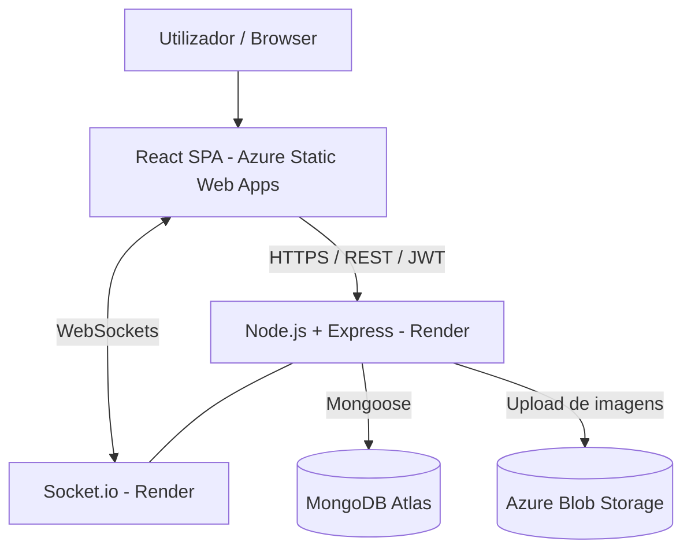

# Do Campo à Mesa

**Mercado digital de produtores locais com encomendas e leilões em tempo real.**

Projeto individual desenvolvido no âmbito da unidade curricular de **Desenvolvimento Web e para a Cloud**, do Mestrado em Engenharia Informática da Escola Superior de Tecnologia e Gestão do Instituto Politécnico de Viana do Castelo (ESTG-IPVC), ano letivo 2026/2027.

A aplicação permite aproximar produtores locais e compradores através de uma plataforma web responsiva, disponibilizando um catálogo de produtos, gestão de encomendas, avaliações e leilões em tempo real.

## 1. Aplicação publicada

| Serviço | Endereço |

|---|---|

| Frontend React | https://blue-moss-0a0dea503.4.azurestaticapps.net |

| Backend REST | https://dcm-api-eduarda.onrender.com |

| Documentação Swagger | https://dcm-api-eduarda.onrender.com/api-docs |

| Health Check | https://dcm-api-eduarda.onrender.com/api/health |

| Repositório GitHub | https://github.com/eduardagomes12/do-campo-a-mesa |

O frontend encontra-se alojado no Azure Static Web Apps e o backend no Render. A persistência é assegurada pelo MongoDB Atlas, enquanto as imagens dos produtos são armazenadas no Azure Blob Storage.

**Nota:** o backend utiliza o plano gratuito do Render, podendo suspender temporariamente a execução após períodos de inatividade. O primeiro pedido após essa suspensão pode demorar mais tempo.

## 2. Tecnologias utilizadas

### Frontend

- React 18

- Vite 5

- React Router 6

- Bootstrap 5

- SASS/SCSS

- Context API e hooks React

- Socket.io Client

### Backend

- Node.js

- Express 4

- MongoDB e Mongoose

- Socket.io

- JSON Web Tokens (JWT)

- bcryptjs

- Multer

- Swagger UI e OpenAPI 3.0

### Cloud e ferramentas

- Azure Static Web Apps — alojamento do frontend

- Render — alojamento da API e do servidor Socket.io

- MongoDB Atlas — base de dados NoSQL

- Azure Blob Storage — armazenamento das imagens

- GitHub Actions — integração e publicação contínuas

- Git e GitHub — controlo de versões

## 3. Arquitetura

A aplicação segue uma arquitetura cliente-servidor, com separação entre interface, lógica de negócio, comunicação em tempo real e persistência.



O frontend comunica com a API REST através de HTTPS. Para os leilões e notificações em tempo real, utiliza Socket.io.

O servidor Express e o servidor Socket.io partilham o mesmo servidor HTTP, estando ambos alojados no Render.

## 4. Funcionalidades implementadas

### Visitante

- Consultar o catálogo de produtos.

- Pesquisar produtos por nome.

- Filtrar produtos por categoria e outros critérios disponíveis.

- Consultar os detalhes de um produto.

- Consultar perfis públicos dos produtores.

- Visualizar os leilões disponíveis.

- Criar uma conta e iniciar sessão.

### Comprador

- Autenticação através de JWT.

- Adicionar produtos ao carrinho.

- Criar e consultar encomendas.

- Consultar o estado das encomendas.

- Avaliar produtos e produtores após a entrega.

- Participar em leilões em tempo real.

- Consultar o histórico de licitações.

- Receber notificações sobre o resultado dos leilões e alterações das encomendas.

### Produtor

- Gerir os dados da exploração.

- Criar, consultar, editar e remover produtos.

- Carregar fotografias dos produtos.

- Consultar e gerir as encomendas recebidas.

- Atualizar os estados das encomendas.

- Criar e acompanhar leilões.

- Consultar as licitações e os resultados dos leilões.

- Receber notificações em tempo real.

O acesso às funcionalidades de produtor depende da validação da conta pelo administrador.

### Administrador

- Validar ou rejeitar pedidos de registo de produtores.

- Consultar estatísticas da plataforma.

- Moderar produtos.

- Consultar e moderar avaliações denunciadas.

- Acompanhar os leilões através do painel administrativo.

## 5. Estrutura do projeto

```text
do-campo-a-mesa/
│
├── api/
│   ├── src/
│   │   ├── config/          Configuração do MongoDB
│   │   ├── middleware/      JWT, permissões e erros
│   │   ├── models/          Modelos Mongoose
│   │   ├── routes/          Endpoints REST
│   │   ├── seed/            Dados de demonstração
│   │   ├── services/        Imagens e ciclo dos leilões
│   │   ├── sockets/         Eventos em tempo real
│   │   ├── app.js           Configuração do Express
│   │   └── server.js        Arranque HTTP e Socket.io
│   ├── test/                Testes automatizados
│   ├── openapi.yaml         Especificação OpenAPI
│   └── package.json
│
├── web/
│   ├── public/              Ficheiros públicos e configuração SPA
│   ├── src/
│   │   ├── api/             Cliente HTTP
│   │   ├── components/      Componentes reutilizáveis
│   │   ├── context/         Sessão, carrinho e Socket.io
│   │   ├── hooks/           Hooks personalizados
│   │   ├── pages/           Páginas da aplicação
│   │   ├── styles/          SASS e estilos responsivos
│   │   ├── App.jsx          Rotas e estrutura da SPA
│   │   └── main.jsx
│   └── package.json
│
├── docs/
│   └── relatorio.md         Relatório técnico
│
└── README.md
```

## 6. Instalação e execução local

### 6.1. Pré-requisitos

- Node.js 20 ou superior

- npm

- Acesso a uma instância MongoDB compatível com Mongoose

- Git

Para testar todas as funcionalidades de carregamento de imagens, é necessária uma configuração válida de armazenamento.

### 6.2. Clonar o repositório

```bash
git clone https://github.com/eduardagomes12/do-campo-a-mesa.git
cd do-campo-a-mesa
```

### 6.3. Configurar o backend

Entrar na pasta da API:

```bash
cd api
npm install
```

Criar o ficheiro `api/.env` com as variáveis necessárias:

```dotenv
PORT=3000
NODE_ENV=development
MONGODB_URI=<connection-string-mongodb>
JWT_SECRET=<segredo-jwt>
JWT_EXPIRES_IN=2h
CLIENT_URL=http://localhost:5173
STORAGE_CONN=<connection-string-azure-storage>
STORAGE_CONTAINER=produtos
```

Substituir os valores entre `< >` pelos valores adequados ao ambiente.

As credenciais não devem ser publicadas no repositório.

Iniciar a API:

```bash
npm run dev
```

A API ficará disponível em:

- http://localhost:3000/api/health

- http://localhost:3000/api/products

- http://localhost:3000/api-docs

### 6.4. Configurar o frontend

Abrir outro terminal e executar:

```bash
cd web
npm install
```

Criar o ficheiro `web/.env.local`:

```dotenv
VITE_API_URL=http://localhost:3000
VITE_USAR_DADOS_SIMULADOS=false
```

Iniciar o frontend:

```bash
npm run dev
```

A aplicação ficará disponível em:

http://localhost:5173

### 6.5. Compilar o frontend

Para gerar a versão de produção:

```bash
cd web
npm run build
```

Os ficheiros estáticos são gerados na pasta `web/dist`.

## 7. Base de dados

A aplicação utiliza MongoDB Atlas, através da biblioteca Mongoose.

Foram definidos seis modelos principais:

| Modelo | Finalidade |

|---|---|

| User | Contas, papéis e dados dos produtores |

| Product | Produtos disponíveis no catálogo |

| Order | Encomendas e respetivas linhas |

| Auction | Leilões, datas, regras e licitação atual |

| Bid | Histórico de licitações |

| Review | Avaliações de produtos e produtores |

### Decisões de modelação

As linhas de uma encomenda são armazenadas no próprio documento da encomenda, preservando informações como o nome do produto, a quantidade e o preço unitário no momento da compra.

As avaliações são armazenadas numa coleção independente, utilizando referências `ObjectId` para o autor, o produtor, o produto e a encomenda associada.

Esta abordagem facilita a consulta e moderação das avaliações, evitando o crescimento descontrolado dos documentos de produtos ou produtores.

As licitações são igualmente guardadas numa coleção própria, permitindo consultar o histórico de cada leilão.

### Dados de demonstração

O backend disponibiliza o comando:

```bash
cd api
npm run seed
```

**Atenção:** este comando apaga os dados existentes nas coleções utilizadas pelo seed e cria novos dados de demonstração.

Não deve ser executado na base de dados de produção.

## 8. API REST

A API segue uma organização baseada em recursos e utiliza os métodos HTTP adequados às diferentes operações.

Os principais recursos são:

| Prefixo | Responsabilidade |

|---|---|

| `/api/auth` | Registo, login e utilizador autenticado |

| `/api/products` | Catálogo e gestão de produtos |

| `/api/producers` | Informação dos produtores |

| `/api/orders` | Criação e gestão de encomendas |

| `/api/auctions` | Gestão e consulta de leilões |

| `/api/reviews` | Avaliações e denúncias |

| `/api/admin` | Administração e moderação |

A API utiliza códigos HTTP como `200`, `201`, `204`, `400`, `401`, `403`, `404` e `409`, conforme o resultado de cada operação.

### Documentação Swagger

A especificação encontra-se no ficheiro `api/openapi.yaml`.

A documentação interativa está disponível em:

https://dcm-api-eduarda.onrender.com/api-docs

Foi validada a execução de pedidos pelo Swagger, incluindo a consulta pública de produtos e a rejeição de operações protegidas quando não é apresentado um token válido.

## 9. Autenticação e segurança

A autenticação é realizada através de JSON Web Tokens (JWT).

Após um login válido, o servidor devolve um token que identifica o utilizador e permite aceder às operações protegidas.

As passwords são armazenadas como hashes, utilizando bcryptjs.

O middleware de autenticação verifica a validade do token e as permissões associadas ao papel do utilizador.

Os papéis considerados são:

- Comprador

- Produtor

- Administrador

O registo público não permite criar contas de administrador.

As credenciais de bases de dados, armazenamento e assinatura JWT são configuradas através de variáveis de ambiente e não devem ser incluídas no código versionado.

A comunicação com os serviços públicos utiliza HTTPS.

## 10. Leilões em tempo real

Os leilões utilizam Socket.io para permitir a comunicação bidirecional entre o servidor e os participantes.

Cada leilão possui uma sala própria, permitindo transmitir eventos apenas aos utilizadores que o acompanham.

O sistema inclui:

- Entrada e saída das salas.

- Contagem de participantes.

- Licitações em tempo real.

- Atualização do maior valor.

- Histórico de licitações.

- Abertura e encerramento automático dos leilões.

- Notificações a compradores e produtores.

- Criação de encomenda para o vencedor.

### Consistência das licitações

Para evitar conflitos entre licitações simultâneas, o backend utiliza uma atualização condicional atómica no MongoDB.

A operação verifica o estado do leilão, as datas de início e fim e o incremento mínimo exigido antes de atualizar o maior valor.

O registo da licitação no histórico e a atualização do leilão são realizados numa transação MongoDB.

Desta forma, duas licitações concorrentes sobre o mesmo valor não devem ser ambas aceites quando deixam de cumprir a condição de incremento.

### Encerramento dos leilões

Um serviço periódico verifica os leilões e atualiza o seu estado conforme as datas definidas.

No encerramento, o servidor identifica o vencedor, cria a encomenda correspondente e emite as notificações necessárias.

**Limitação conhecida:** em determinadas situações, a interface pode necessitar de uma atualização manual da página para apresentar imediatamente o estado final do leilão. O resultado permanece persistido na base de dados.

Além disso, a suspensão por inatividade do plano gratuito do Render pode interromper temporariamente o processamento periódico dos leilões.

## 11. Testes

Foram realizados testes funcionais e de integração durante o desenvolvimento, incluindo autenticação, permissões, operações REST, comunicação Socket.io e concorrência entre licitações.

O backend possui testes automatizados com o módulo nativo de testes do Node.js.

Para os executar, com a API local e a base de dados de testes preparadas:

```bash
cd api
npm test
```

A suite inclui sete testes automatizados, incluindo validações de autenticação, autorização e concorrência.

### Resultado da última execução

Na última execução de `npm test`, **6 dos 7 testes foram aprovados**. As seis verificações de disponibilidade da API, autenticação e permissões passaram. No teste de concorrência, as verificações internas também confirmaram que, perante duas propostas simultâneas de 105 € sobre um leilão de 100 €, **uma foi aceite e outra recusada**, mantendo o valor final e o histórico consistentes.

Numa rajada de dez propostas concorrentes, quatro foram aceites e seis recusadas, sem divergências entre o histórico, o contador e o valor final do leilão.

No entanto, o sétimo teste terminou com um **timeout ao aguardar o evento Socket.io `terminado`**. Assim, essa execução não permite considerar como aprovada toda a validação automatizada do encerramento e das notificações, apesar dos resultados positivos obtidos nas verificações de concorrência e persistência.

```text
Tests: 7
Pass: 6
Fail: 1
Erro: Não chegou o evento terminado
```

Os detalhes da execução e das verificações manuais estão documentados em `docs/relatorio.md`.


Foi também realizada uma validação manual da aplicação publicada, nomeadamente:

- Consulta de produtos através da API e do Swagger.

- Visualização do catálogo e das imagens armazenadas na Cloud.

- Autenticação e acesso às áreas protegidas.

- Participação em leilões por diferentes compradores.

- Atualização de licitações e histórico.

- Apresentação do resultado do leilão e notificações em tempo real.

Os testes automatizados que criam ou alteram dados devem ser executados num ambiente de testes, evitando alterações indesejadas nos dados de produção.

## 12. Deployment Cloud

A solução encontra-se distribuída por diferentes serviços Cloud.

| Componente | Serviço | Modelo |

|---|---|---|

| Frontend | Azure Static Web Apps | PaaS |

| Backend | Render Web Service | PaaS |

| Base de dados | MongoDB Atlas | DBaaS |

| Imagens | Azure Blob Storage | Serviço gerido de armazenamento |

| CI/CD do frontend | GitHub Actions | Serviço gerido de automação |

### Frontend

O Azure Static Web Apps compila e distribui a aplicação React.

A publicação é automatizada por um workflow GitHub Actions associado à branch `main`.

A variável `VITE_API_URL` identifica o endereço público do backend durante a compilação.

### Backend

O Render executa a API Node.js através do comando:

```bash
npm start
```

O serviço utiliza variáveis de ambiente para configurar o MongoDB, JWT, origem permitida do frontend e armazenamento das imagens.

### Armazenamento de imagens

As fotografias dos produtos são enviadas através da API e armazenadas num contentor Azure Blob Storage.

Na base de dados é guardado o URL da imagem, em vez do ficheiro binário.

### Custos

O frontend e o backend utilizam planos gratuitos. O MongoDB Atlas é utilizado conforme o plano do cluster configurado.

O Azure Blob Storage pode gerar custos associados ao armazenamento, às operações e à transferência de dados, de acordo com a utilização.

## 13. Limitações e trabalho futuro

Durante o desenvolvimento foram identificadas dificuldades relacionadas com a ligação entre os diferentes serviços Cloud, a autorização de IPs no MongoDB Atlas, a configuração das variáveis de ambiente e o encaminhamento das rotas da SPA.

Inicialmente, foi tentada a publicação do backend no Azure App Service. Contudo, devido a falhas persistentes no arranque, foi adotado o Render como solução de alojamento.

Como melhorias futuras, destacam-se:

- Tornar mais robusta a sincronização visual do encerramento dos leilões.

- Avaliar um serviço de alojamento que mantenha o processamento dos leilões continuamente ativo.

- Aumentar a cobertura dos testes automatizados.

- Melhorar a monitorização e o diagnóstico dos serviços.

- Aperfeiçoar a experiência de utilização em dispositivos móveis.

## 14. Documentação

O relatório técnico encontra-se em:

`docs/relatorio.md`

O relatório apresenta as decisões de arquitetura, a implementação, a segurança, o modelo de dados, a consistência dos leilões, o deployment Cloud e as principais dificuldades.

## 15. Utilização de ferramentas de IA

Foi utilizado o **ChatGPT (OpenAI)** como ferramenta de apoio ao desenvolvimento, nomeadamente na explicação de conceitos, análise de mensagens de erro, configuração dos serviços Cloud, preparação de testes e estruturação e revisão da documentação. As sugestões foram analisadas e integradas de forma crítica, de acordo com as necessidades do projeto, mantendo-se a responsabilidade pela implementação e validação do trabalho.

## 16. Autoria

**Projeto individual — Desenvolvimento Web e para a Cloud**

Mestrado em Engenharia Informática

Escola Superior de Tecnologia e Gestão

Instituto Politécnico de Viana do Castelo

Ano letivo 2026/2027
