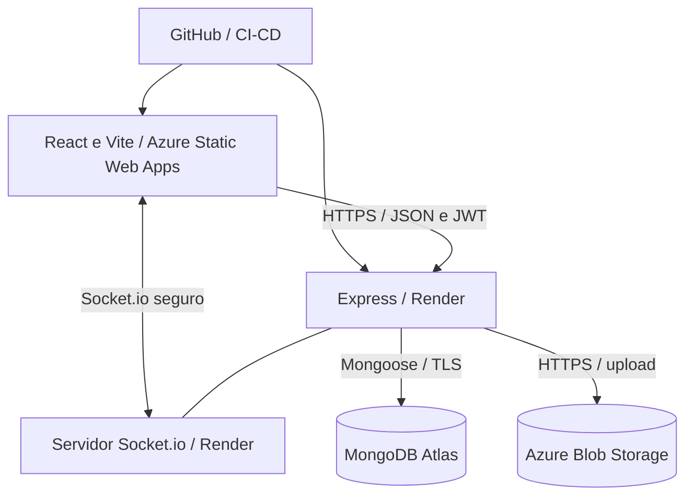
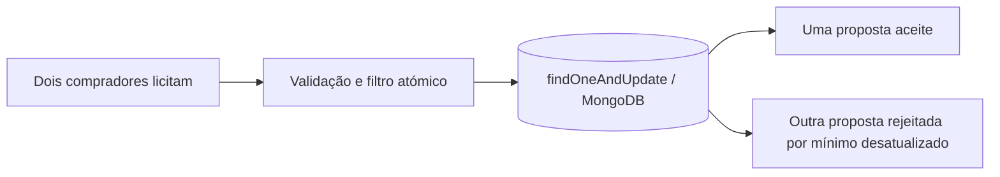

# Do Campo à Mesa — Relatório técnico

**Desenvolvimento Web e para a Cloud · Mestrado em Engenharia Informática · ESTG–IPVC · 2026/2027**

## 1. Introdução

O projeto «Do Campo à Mesa» consiste no desenvolvimento de um mercado digital que aproxima pequenos produtores agrícolas de compradores particulares e de entidades de restauração. O objetivo é disponibilizar, numa única aplicação web, um catálogo de produtos locais, uma área de encomendas e um mecanismo de leilões em tempo real para lotes sazonais ou excedentes de produção.

O trabalho foi realizado no âmbito da unidade curricular de Desenvolvimento Web e para a Cloud, do Mestrado em Engenharia Informática, e combina os conteúdos de frontend responsivo, Single Page Application (SPA), API REST, persistência NoSQL, autenticação, comunicação em tempo real e deployment em serviços Cloud geridos.

Foram considerados quatro perfis: visitante, comprador, produtor e administrador. O visitante pode consultar produtos, produtores e leilões; o comprador pode criar encomendas, avaliar após a entrega e licitar; o produtor gere produtos, a sua exploração, encomendas e leilões; o administrador aprova produtores e modera conteúdos. Estas permissões são verificadas no servidor, e não apenas escondidas na interface.

A solução foi publicada com frontend no Azure Static Web Apps, backend no Render, base de dados no MongoDB Atlas e fotografias no Azure Blob Storage. O projeto foi validado com testes locais e verificações em ambiente público, incluindo chamadas à API via Swagger, navegação no catálogo, imagens armazenadas na Cloud e licitações entre utilizadores.

## 2. Arquitetura

A arquitetura segue uma separação entre apresentação, lógica aplicacional, comunicação em tempo real e persistência. O browser executa uma SPA React compilada pelo Vite; os pedidos HTTP são enviados por HTTPS à API Express. O mesmo processo Node.js disponibiliza também o servidor Socket.io, ligado ao servidor HTTP partilhado. A API utiliza Mongoose para comunicar com o MongoDB Atlas e o SDK Azure para guardar imagens em Blob Storage.



*Figura 1 — Diagrama de componentes e dos principais canais de comunicação da solução publicada.*

### 2.1. Fluxos de comunicação

Nos pedidos REST, o cliente envia e recebe JSON através de endpoints sob o prefixo `/api`. Os pedidos protegidos transportam o token JWT no cabeçalho `Authorization: Bearer`. O carregamento de fotografias utiliza `multipart/form-data`; o ficheiro é enviado ao backend, que o coloca no Blob Storage e persiste apenas o respetivo URL no documento MongoDB do produto.

Nos leilões, a SPA estabelece uma ligação Socket.io autenticada e entra numa sala identificada pelo leilão. O servidor transmite atualizações de licitações e presença à sala; eventos relativos a encomendas e ao resultado de leilões são também enviados para salas pessoais de utilizador.

O serviço de leilões verifica periodicamente a abertura e o fim dos eventos com base nas datas armazenadas na base de dados.

### 2.2. Separação de responsabilidades

A API concentra regras de negócio e validações, evitando decisões sensíveis no navegador. A base de dados assegura persistência, índices e transações.

O armazenamento de objetos evita dependência do sistema de ficheiros efémero do serviço de alojamento. O GitHub funciona como repositório de código e base para os pipelines de publicação automática.

Esta separação permite desenvolver e publicar o frontend e o backend de forma independente, mantendo a comunicação através de interfaces bem definidas.

## 3. Frontend e SPA

### 3.1. Tecnologias e componentes

Foi escolhido React 18 com Vite por permitir organizar a interface em componentes reutilizáveis, atualizar seletivamente o ecrã sem recarregar a página e manter uma estrutura de desenvolvimento simples para um projeto individual.

O Vite oferece um servidor de desenvolvimento rápido e gera a versão estática distribuída pelo Azure Static Web Apps. A interface utiliza Bootstrap 5 e SASS, com variáveis de tema e mixins próprios.

A aplicação inclui componentes como `Navbar`, `CartaoProduto`, `RotaProtegida`, `EstadoEncomenda`, `Notificacoes` e elementos de gestão de produtor.

As páginas contemplam catálogo, detalhe de produto, perfil público de produtor, carrinho, encomendas, leilões, sala do leilão e painéis específicos de produtor e administrador.

### 3.2. Navegação e gestão de estado

O React Router gere a navegação pelo lado do cliente, incluindo rotas públicas (`/` e `/produtos/:id`), rotas autenticadas (`/leiloes/:id`) e áreas protegidas por papel (`/carrinho`, `/produtor` e `/admin`).

A componente `RotaProtegida` limita a navegação, mas a autorização efetiva permanece no backend.

O `AuthContext` centraliza a sessão e os dados do utilizador; o `CarrinhoContext` gere os produtos selecionados e a sua persistência local.

O `SocketContext` disponibiliza a ligação partilhada ao servidor de eventos e o hook `useLeilao` mantém o estado do leilão, histórico, presença, contagem decrescente e resultado.

Para a interface foram utilizados estados locais e efeitos React, sem necessidade de uma biblioteca global adicional. O cliente HTTP concentra a construção do endereço base e o envio do JWT.

### 3.3. Mobile First e responsividade

A estratégia Mobile First parte de estilos adaptados a ecrãs pequenos e acrescenta regras de composição com media queries de `min-width`.

O projeto define três breakpoints em SASS:

- **768 px (md):** adaptação para tablets e ecrãs intermédios;
- **1024 px (lg):** reorganização dos elementos para desktop;
- **1280 px (xl):** utilização de áreas de conteúdo mais amplas.

O mixin `a-partir-de()` e as classes responsivas do Bootstrap são utilizados para ajustar a grelha do catálogo, a disposição de cartões, painéis e elementos de navegação.

A paleta visual é parametrizada em SASS com verde, terracota e tons neutros, permitindo consistência entre páginas.

A publicação estática inclui uma regra `navigationFallback` para `index.html`, necessária para que uma ligação direta ou o refresh de uma rota interna seja entregue ao React Router, em vez de originar um erro 404 do alojamento.

## 4. API REST e documentação

O backend foi implementado em Node.js 22 e Express 4. Os recursos principais estão organizados em routers por domínio, com prefixos `/api/auth`, `/api/products`, `/api/producers`, `/api/orders`, `/api/auctions`, `/api/reviews` e `/api/admin`.

O endpoint `/api/health` suporta verificações de disponibilidade. O processamento de erros é centralizado para produzir respostas JSON consistentes.

| Recurso / exemplos | Operações principais | Objetivo |
|---|---|---|
| `/auth` | POST registo e login; GET /eu | Conta, autenticação e identificação da sessão |
| `/products` | GET pesquisa/detalhe; POST, PUT, DELETE; POST imagem | Catálogo, filtros, moderação e fotografias |
| `/producers` | GET lista/detalhe; PATCH /me | Perfil e exploração do produtor |
| `/orders` | POST; GET lista/detalhe; PATCH estado | Compra, stock e ciclo de encomendas |
| `/auctions` | GET lista/detalhe/histórico; POST | Criação e consulta de leilões |
| `/reviews` | GET; POST; POST denúncia | Avaliações e denúncias |
| `/admin` | GET estatísticas e pendentes; PATCH validação/moderação | Operações de administração |

A API utiliza os métodos HTTP de acordo com a operação:

- `GET` para consulta de recursos;
- `POST` para criação;
- `PUT` para atualização completa de produtos;
- `PATCH` para alterações parciais;
- `DELETE` para remoção.

Foram utilizadas respostas HTTP como `200` (sucesso), `201` (recurso criado), `204` (remoção sem corpo), `400` (pedido inválido), `401` (não autenticado), `403` (sem permissão), `404` (não encontrado) e `409` (conflito de negócio, incluindo stock insuficiente ou mudança de estado inválida).

### 4.1. Documentação OpenAPI e validação

A especificação OpenAPI 3.0 é disponibilizada pela biblioteca Swagger UI em:

https://dcm-api-eduarda.onrender.com/api-docs

O campo `servers` foi configurado com a base `/api` do serviço publicado; assim, uma operação descrita como `/products` é executada sobre `/api/products`.

Esta correção foi necessária após os primeiros testes, que apontaram para `localhost` e, posteriormente, para um caminho sem o prefixo `/api`.

No ambiente publicado, a operação `GET /api/products` foi executada no Swagger com resposta HTTP `200` e dados provenientes da base de dados.

A operação `POST /api/products` sem token devolveu `401`, comportamento esperado numa rota protegida.

Estas verificações demonstram a acessibilidade pública da documentação e o controlo de autenticação, sem substituir testes exaustivos de todas as rotas.

## 5. Modelo de dados

A persistência utiliza MongoDB Atlas e modelos Mongoose. Foram identificadas seis coleções principais: `users`, `products`, `orders`, `auctions`, `bids` e `reviews`.

O desenho combina referências `ObjectId` (*linking*) para entidades que evoluem de forma independente com subdocumentos embebidos (*embedding*) para informação pequena e normalmente consultada em conjunto.

| Coleção | Estrutura relevante | Opção de modelação |
|---|---|---|
| `users` | Identidade, papel, dados da exploração e aprovação | Dados específicos de produtor embebidos no utilizador |
| `products` | Produtor, categoria, preço, stock, épocas, imagemUrl | Referência ObjectId ao produtor |
| `orders` | Comprador, produtor, linhas, entrega, estado | Linhas e dados de entrega embebidos; referências às pessoas |
| `auctions` | Produtor, produto, datas, licitação atual, estado | Licitação atual embebida; referências a utilizadores/produto |
| `bids` | Leilão, comprador, valor e data | Histórico separado do documento de leilão |
| `reviews` | Autor, produtor, produto, encomenda, classificação | Coleção própria com referências ObjectId |

### 5.1. Embedding versus linking

Nas encomendas, as linhas são embebidas porque representam um conjunto limitado, consultado juntamente com a compra.

Conservam nome, preço unitário e quantidade registados no momento da encomenda, mesmo que o catálogo seja atualizado posteriormente. Os dados de entrega também são mantidos no mesmo documento.

Nos leilões, a `licitacaoAtual` está embebida em `auctions`, permitindo comparar e atualizar o valor vigente numa operação atómica sobre um único documento.

Em contrapartida, o histórico de propostas é guardado separadamente em `bids`. Esta separação evita o crescimento ilimitado do documento do leilão e permite consultas ordenadas das últimas licitações.

As avaliações foram colocadas na coleção `reviews`, com referências `ObjectId` a autor, produtor e, quando aplicável, produto e encomenda.

Esta escolha permite:

- Consultar avaliações por produtor ou produto;
- Moderar avaliações individualmente;
- Associar avaliações a encomendas concretas;
- Evitar o crescimento contínuo dos documentos de produtos e produtores;
- Facilitar consultas e operações administrativas.

A avaliação só é aceite para uma encomenda do próprio comprador no estado entregue, existindo ainda proteção contra duplicados através de um índice único parcial.

Esta decisão de modelação privilegia a independência e a consulta das avaliações, em vez de as armazenar diretamente nos documentos de produtos ou produtores.

### 5.2. Índices e pesquisas

Os índices declarados no código incluem email único em `users`; em `products`, índices compostos `{produtor: 1, createdAt: -1}` e `{categoria: 1, preco: 1}`; em `auctions`, índices para produtor, estado e `terminaEm`; em `bids`, índice sobre `leilao`; e em `orders`, índices sobre comprador e produtor.

Em `reviews`, o índice composto único `(autor, encomenda, produto)`, limitado a documentos com encomenda do tipo `ObjectId`, impede duplicações por alvo e encomenda.

Esta descrição corresponde às definições Mongoose identificadas no código, não a medições de desempenho dos índices no Atlas.

O catálogo aplica pesquisa textual com expressões regulares (`RegExp` com opção `i`) sobre nome e descrição e uma consulta auxiliar a produtores.

Utiliza `$lte` para filtrar `precoMax` e `$in` para categorias ou épocas pertinentes.

A compra utiliza `stock: {$gte: quantidade}` para reservar existências sem permitir valores negativos.

Os leilões utilizam `iniciaEm: {$lte: agora}` e `terminaEm: {$lt: agora}` na seleção de itens a abrir ou encerrar.

Exemplos de consultas MongoDB:

```javascript
{ preco: { $lte: 10 } }

{ stock: { $gte: 2 } }

{ terminaEm: { $lt: new Date() } }
```

Estas operações demonstram a utilização de filtros, operadores e índices na implementação das regras de negócio.

## 6. Segurança

A autenticação é baseada em JSON Web Tokens (JWT). Após um login válido, a API assina um token com identificador, nome e papel do utilizador; a expiração configurada é de duas horas.

O cliente inclui o token nas chamadas protegidas através do cabeçalho `Authorization`.

O middleware valida assinatura e expiração, confirma a existência atual do utilizador na base de dados e verifica o seu papel.

O controlo de acesso distingue comprador, produtor e administrador:

- A gestão de produtos e a criação de leilões exigem o papel de produtor e aprovação administrativa;
- A submissão de licitações exige o papel de comprador;
- As operações administrativas exigem o papel de administrador.

São devolvidos códigos `401` para token ausente ou inválido e `403` para papel insuficiente.

No registo, o backend valida email, nome e password, restringe a criação pública aos papéis comprador/produtor e utiliza `bcryptjs` com fator de custo 12 para armazenar apenas `passwordHash`.

O modelo exclui esse campo das consultas normais e disponibiliza uma representação pública sem o hash.

O handshake Socket.io valida o JWT, consulta o utilizador e impede ligações não autorizadas.

O frontend e a API são servidos por HTTPS. Para Socket.io, a ligação segura utiliza o mesmo domínio HTTPS e o transporte WebSocket quando disponível.

A configuração `CLIENT_URL` limita a origem aceite pelas políticas CORS.

No Render, `MONGODB_URI`, `JWT_SECRET` e `STORAGE_CONN` são variáveis de ambiente e não são colocadas no repositório; o frontend contém apenas `VITE_API_URL`, variável pública de compilação.

Estas medidas reduzem riscos comuns, mas não equivalem a uma auditoria de segurança formal.

A persistência de sessão em `localStorage`, por exemplo, exige atenção à prevenção de XSS. Numa evolução futura poderá ser considerada uma estratégia de cookies `HttpOnly` e `Secure`, complementada por políticas de cabeçalhos, rate limiting e testes de segurança.

## 7. Tempo real e consistência dos leilões

### 7.1. Salas, eventos e presença

O Socket.io utiliza o mesmo servidor HTTP do Express.

Depois de autenticar o JWT no handshake, cada ligação integra a sala pessoal `user:<id>`; administradores juntam-se a `admin:leiloes`.

Quando abre uma sala de leilão, o cliente emite `entrar` com o identificador. O servidor consulta o leilão e as últimas 20 propostas, executa `socket.join(leilao:<id>)` e devolve o evento `estado` com a hora atual do servidor.

Os eventos principais são:

| Evento | Finalidade |
|---|---|
| `estado` | Enviar o estado atual do leilão |
| `presenca` | Atualizar o número de participantes |
| `nova-licitacao` | Informar os participantes de uma licitação aceite |
| `recusada` | Comunicar uma licitação inválida |
| `aberto` | Informar que um leilão começou |
| `terminado` | Informar que um leilão terminou |
| `leilao-ganho` | Notificar o comprador vencedor |
| `leilao-terminado` | Notificar o produtor |
| `nova-encomenda` | Informar o produtor de uma nova encomenda |
| `encomenda-atualizada` | Informar alterações do estado de uma encomenda |

O contador da interface considera o desvio entre o relógio do cliente e a hora comunicada pelo servidor, reduzindo divergências visuais entre participantes.

### 7.2. Validação e simultaneidade

A regra central é que duas ofertas concorrentes não podem ambas ser aceites com base no mesmo preço anterior.

O servidor não confia no valor exibido pelo browser: valida identidade do comprador, formato monetário, leilão ativo, intervalo temporal e incremento mínimo.

A operação `findOneAndUpdate` aplica, no mesmo filtro, as condições:

- `estado = ativo`;
- `iniciaEm <= agora`;
- `terminaEm > agora`;
- `licitacaoAtual.valor <= valor - incremento`.

Assim, uma proposta só é aplicada se continuar válida no instante da atualização.



*Figura 2 — Atualização condicional do preço e rejeição de uma oferta concorrente já desatualizada.*

A atualização da licitação atual, o incremento do contador e a criação do registo em `bids` decorrem na mesma transação MongoDB.

O broadcast `nova-licitacao` é realizado apenas após o sucesso da operação.

Em testes com duas propostas simultâneas, só uma foi aceite. Esta evidência valida o cenário testado, sem constituir uma prova formal para qualquer volume de concorrência.

### 7.3. Abertura, encerramento e consistência

Um ciclo executado no servidor verifica de dois em dois segundos os leilões agendados que devem abrir e os leilões cujo prazo terminou.

A alteração do estado para `terminado` ocorre numa transação que cria uma encomenda confirmada para o vencedor e guarda a referência no leilão, quando existe uma licitação vencedora.

A condição de atualização evita repetir o encerramento de um leilão já terminado. Os eventos de resultado são enviados após o sucesso da transação.

Em produção, foi observado que o backend regista o estado final e o vencedor e envia notificações Socket.io sem atualização manual.

No entanto, a página de detalhe pode permanecer visualmente em «A aguardar encerramento» até ocorrer refresh.

Por essa razão, a atualização visual instantânea do estado final é registada como limitação conhecida, distinta da persistência e da notificação do resultado.

### 7.4. Evidências de testes e validação

A aplicação foi validada através de testes automatizados e testes manuais, incluindo verificações realizadas no ambiente de produção.

Os testes automatizados foram implementados com o módulo nativo `node:test` do Node.js, utilizando pedidos à API REST e clientes Socket.io para simular operações reais.

A suite inclui sete testes, que verificam a disponibilidade da API, autenticação, permissões e consistência das licitações.

#### Testes de autenticação e autorização

Foram realizadas verificações sobre:

- Disponibilidade do endpoint de saúde da API;
- Rejeição de login com password incorreta;
- Login válido de um comprador;
- Restrição do acesso de visitantes às estatísticas administrativas;
- Restrição do acesso de compradores às operações administrativas;
- Rejeição da criação de leilões por compradores.

Na última execução, todas estas seis verificações foram aprovadas.

#### Teste de licitações simultâneas

Para validar o mecanismo de concorrência, foram simuladas duas licitações simultâneas de 105 € sobre um leilão com valor inicial de 100 € e incremento mínimo de 5 €.

Os resultados demonstraram que apenas uma licitação foi aceite, enquanto a outra foi recusada.

O valor final do leilão ficou em 105 €, e o histórico continha apenas uma licitação, de acordo com a operação aceite.

Foi também executada uma rajada de dez licitações concorrentes.

Nesta execução, quatro foram aceites e seis recusadas. A comparação com o MongoDB confirmou que todas as licitações aceites estavam presentes no histórico, mantendo-se consistentes o contador e o maior valor do leilão.

Estes resultados demonstram a importância da atualização condicional atómica e da transação MongoDB para preservar a consistência dos dados.

#### Resultado da última execução automatizada

O comando utilizado foi:

```bash
cd api
npm test
```

A última execução produziu os seguintes resultados relevantes:

```text
✔ API responde ao health check
✔ Login com password errada é recusado
✔ Comprador consegue iniciar sessão
✔ Visitante não acede às estatísticas do administrador
✔ Comprador não acede às funcionalidades do administrador
✔ Comprador não pode criar leilões

PASSOU: uma licitação aceite e uma recusada
PASSOU: valor final de 105 €
PASSOU: histórico contém apenas uma licitação

Rajada: 4 aceites, 6 recusadas

PASSOU: todas as licitações aceites estão no histórico
PASSOU: contador e valor final consistentes

✖ Duas licitações simultâneas: só uma é aceite

tests 7
pass 6
fail 1

Error: Não chegou o evento terminado
```

Embora a lógica de concorrência e as verificações de persistência tenham produzido os resultados esperados, o sétimo teste terminou com um timeout ao aguardar o evento Socket.io `terminado`.

Este teste também incluía a validação do encerramento automático, criação da encomenda do vencedor e receção das notificações.

Por esse motivo, a última execução foi contabilizada como seis testes aprovados e um falhado.

O timeout não permite concluir, isoladamente, que a lógica de concorrência esteja incorreta. Contudo, também não permite considerar toda a validação automatizada do encerramento como aprovada nessa execução.

Durante o desenvolvimento tinham sido obtidos resultados de aprovação integral da suite. A execução posterior evidencia a importância de testar também situações de sincronização e comunicação entre os processos envolvidos.

#### Testes manuais em produção

Além dos testes automatizados, foram realizadas verificações na aplicação publicada.

Foi confirmada a consulta de produtos reais provenientes do MongoDB Atlas, a apresentação das respetivas imagens no Azure Blob Storage e a utilização do sistema por diferentes perfis.

Nos leilões, foram observadas licitações realizadas por compradores distintos, a atualização do maior valor, o histórico e a contagem de participantes.

Após o encerramento, a aplicação apresentou o estado final, o valor vencedor e a identificação do comprador vencedor. As notificações foram recebidas através de Socket.io sem necessidade de atualização manual da página.

Foi também validada a documentação Swagger UI, com a operação `GET /api/products` a devolver HTTP 200 e a operação protegida `POST /api/products` sem token a devolver HTTP 401.

Estes testes confirmam o funcionamento dos principais fluxos da aplicação no ambiente publicado, embora não substituam uma validação exaustiva de todos os cenários possíveis.

## 8. Deployment na Cloud

A solução final utiliza quatro serviços Cloud, cada um com uma responsabilidade isolada.

A arquitetura evoluiu relativamente à proposta inicial de alojar toda a aplicação no Azure: a API foi publicada com sucesso no Render após dificuldades de arranque no Azure App Service F1.

O frontend permaneceu no Azure Static Web Apps e as imagens no Azure Blob Storage; a base de dados está no MongoDB Atlas.

| Serviço | Responsabilidade e modelo | Custos/limites |
|---|---|---|
| Azure Static Web Apps · Free | Alojamento global da SPA; PaaS de frontend estático | 0 € na oferta Free, sujeito a quotas |
| Render Web Service · Free | Node.js, Express e Socket.io; PaaS | 0 € no plano Free, sujeito a limites de utilização e suspensão por inatividade |
| MongoDB Atlas | Base de dados gerida; DBaaS | 0 € se utilizado um cluster Free/M0, dentro dos limites |
| Azure Blob Storage · Standard/LRS | Armazenamento de objetos; serviço gerido de storage | Preço variável por capacidade, operações e tráfego |

### 8.1. Publicação e configuração

O repositório GitHub utiliza a branch `main`.

Um workflow GitHub Actions compila o frontend através de `npm run build`, com saída na pasta `dist`, e publica os ficheiros no Azure Static Web Apps.

O backend é construído no Render a partir da subpasta `api`, utilizando os comandos `npm install` e `npm start`.

A variável pública `VITE_API_URL` aponta para a origem do Render; a variável `CLIENT_URL` limita CORS ao domínio do Azure.

O ficheiro `staticwebapp.config.json` define o fallback das rotas da SPA para `index.html`.

No Render, as configurações sensíveis são introduzidas em Environment. O serviço liga-se ao Atlas através de endereços autorizados na IP Access List.

As imagens são persistidas no contentor `produtos` da conta Azure Storage, em vez de serem guardadas permanentemente no disco do Render, que é efémero no plano gratuito.

### 8.2. Endereços e disponibilidade

**Frontend — Azure Static Web Apps:**

https://blue-moss-0a0dea503.4.azurestaticapps.net

**Backend — Render:**

https://dcm-api-eduarda.onrender.com

**Health Check:**

https://dcm-api-eduarda.onrender.com/api/health

**Swagger UI:**

https://dcm-api-eduarda.onrender.com/api-docs

Na publicação, o Swagger devolveu HTTP 200 em `GET /api/products` e HTTP 401 esperado num POST protegido sem token.

O catálogo carregou produtos e fotografias reais e foram observadas licitações e notificações em tempo real entre utilizadores.

### 8.3. Estimativa de custos e limitações

Para uma demonstração de baixo tráfego, o frontend Azure Static Web Apps Free e o backend Render Free têm custo base de alojamento de 0 €/mês.

O MongoDB Atlas poderá manter custo base nulo se permanecer no tier gratuito.

O Azure Blob Storage é faturado por utilização. O custo real depende da região, classe de armazenamento, operações, volume transferido e regras da subscrição.

Não foi efetuada uma medição de faturação que permita indicar um custo total exato.

O Render Free pode suspender o serviço após aproximadamente 15 minutos sem pedidos HTTP nem mensagens WebSocket recebidas, retomando-o quando houver novo tráfego.

Durante a suspensão, o processo de verificação periódica dos leilões não está ativo. No arranque seguinte, o backend volta a verificar leilões expirados.

Esta característica distingue uma demonstração académica de uma solução com requisitos de disponibilidade contínua.

## 9. Dificuldades e trabalho futuro

### 9.1. Principais dificuldades

**Deployment da API.**

A primeira tentativa no Azure App Service Linux F1 completou o build com Microsoft Oryx, mas o contentor terminou repetidamente durante o arranque.

Foram verificados logs, comando `npm start`, variáveis, quotas do plano e conectividade.

Para reduzir o tempo de resolução, a API foi posteriormente publicada no Render, onde os logs identificaram diretamente uma `MongooseServerSelectionError` associada à impossibilidade de ligação ao Atlas.

A autorização dos IPs de saída do novo serviço resolveu a ligação.

**Documentação e rotas.**

A Swagger UI esteve inicialmente configurada para `localhost` e, depois, para a origem publicada sem o prefixo `/api`.

A configuração do bloco `servers` foi corrigida e a operação `GET /api/products` passou a responder com sucesso.

Na SPA alojada no Azure, um refresh numa rota interna originou um erro 404 até à configuração de `navigationFallback`.

**Eventos e sincronização visual.**

Os clientes recebem novas licitações e notificações sem refresh, mas em algumas circunstâncias a apresentação do estado final do leilão só se atualiza depois de recarregar a página.

Trata-se de uma limitação de sincronização da interface, mantida identificada para trabalho futuro.

**Validação automatizada dos eventos.**

Embora as verificações de concorrência e persistência tenham apresentado resultados consistentes, uma execução posterior da suite de testes terminou com timeout na receção do evento `terminado`.

Esta situação demonstra a necessidade de aprofundar os testes de sincronização e de isolar os serviços utilizados nos cenários de integração.

### 9.2. Melhorias propostas

Como evolução futura, destacam-se:

- Sincronização do estado final dos leilões através de reconexão e nova consulta ao backend;
- Mecanismo de processamento agendado independente do ciclo de vida da instância gratuita;
- Testes de carga, concorrência e recuperação de falhas;
- Ambientes isolados para testes automatizados;
- Monitorização e alertas sobre o estado dos serviços;
- Testes automatizados end-to-end no ambiente publicado;
- Revisão adicional de segurança, acessibilidade e experiência em dispositivos móveis.

A eventual passagem para um serviço com disponibilidade contínua deverá ser avaliada em função dos custos e das necessidades reais da aplicação.

## 10. Declaração de uso de ferramentas

O projeto foi desenvolvido com tecnologias e bibliotecas de código aberto apropriadas a cada camada.

No frontend foram utilizados React, React Router, Vite, Bootstrap, SASS e Socket.io Client.

No backend foram utilizados Node.js, Express, Mongoose, Socket.io, bcryptjs, jsonwebtoken, Multer, swagger-ui-express e @azure/storage-blob.

Foram utilizados Git e GitHub para controlo de versões, GitHub Actions para publicação automática, Swagger UI para explorar e validar os contratos HTTP, MongoDB Atlas para persistência e os portais Azure e Render para configuração e diagnóstico.

Foi também utilizado o assistente ChatGPT (OpenAI) como apoio ao planeamento da implementação, explicação de conceitos, análise de mensagens de erro, configuração Cloud, preparação de testes e estruturação e revisão deste relatório.

As sugestões foram integradas de forma crítica e sujeitas a verificação no código e na execução da aplicação.

O recurso a ferramentas de IA não substitui a autoria individual, a compreensão técnica e a responsabilidade pelo trabalho desenvolvido e entregue.

### Fontes técnicas consultadas

- Enunciado e Guia de Implementação «Do Campo à Mesa», unidade curricular de Desenvolvimento Web e para a Cloud, ESTG–IPVC (2026/2027).
- Microsoft Learn — Azure Static Web Apps: https://learn.microsoft.com/en-us/azure/static-web-apps/configuration
- Microsoft Learn — Custos de Azure Blob Storage: https://learn.microsoft.com/en-us/azure/storage/common/storage-plan-manage-costs
- Render — Deploy for Free: https://render.com/docs/free
- MongoDB Atlas — Pricing: https://www.mongodb.com/pricing
